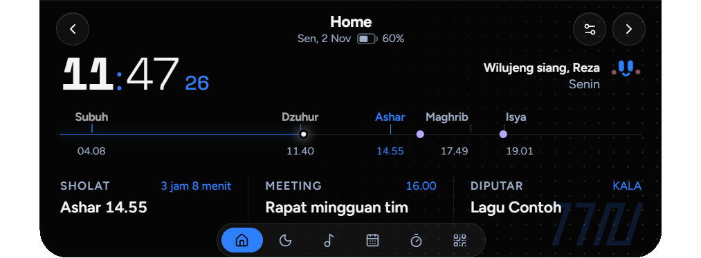
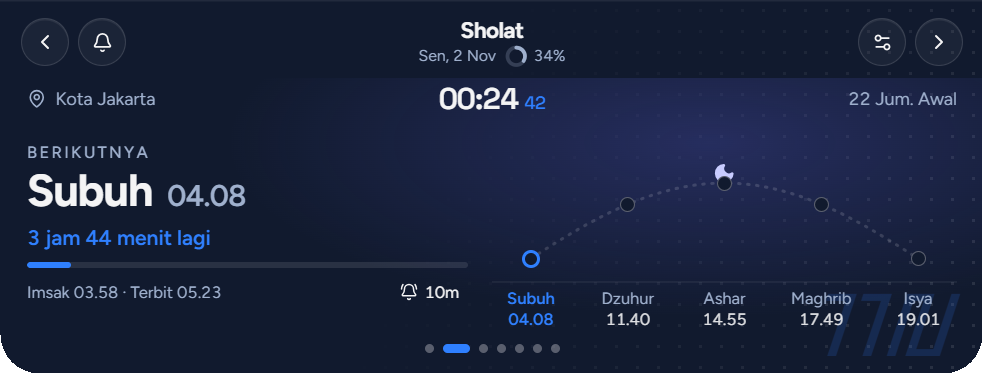
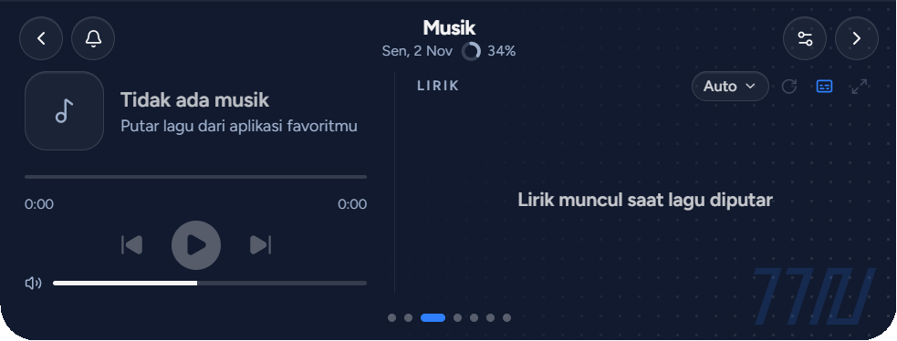
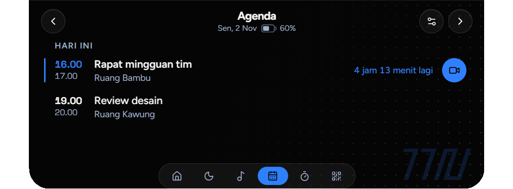
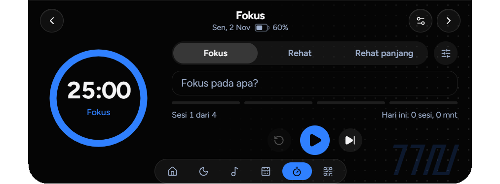
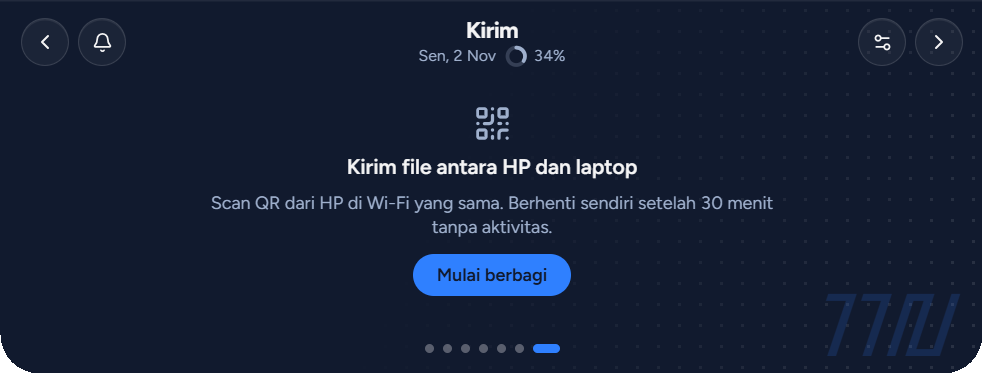
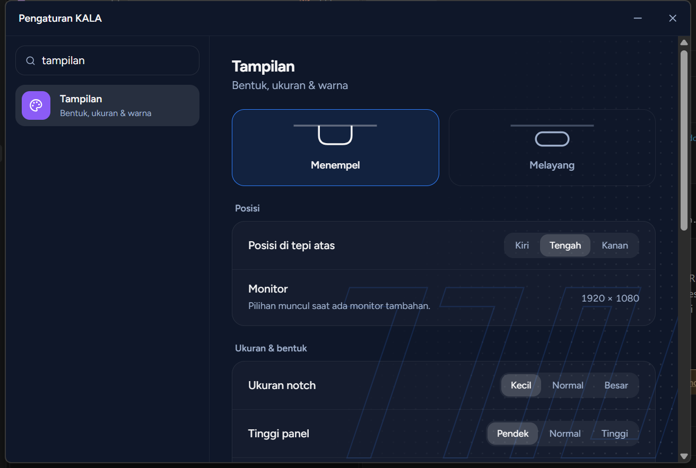
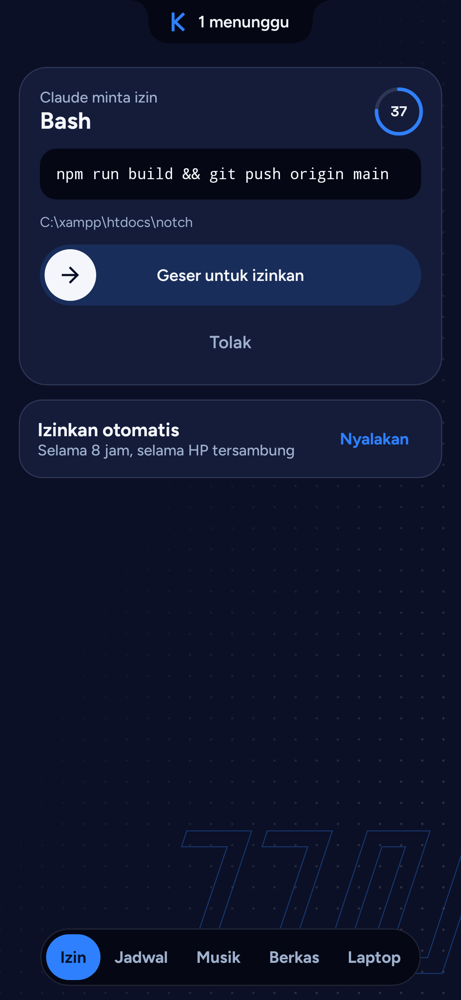
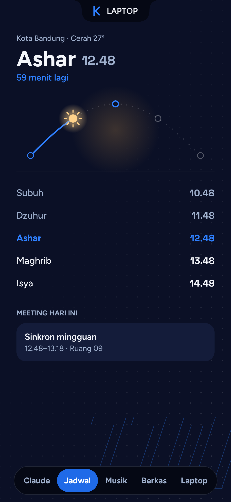
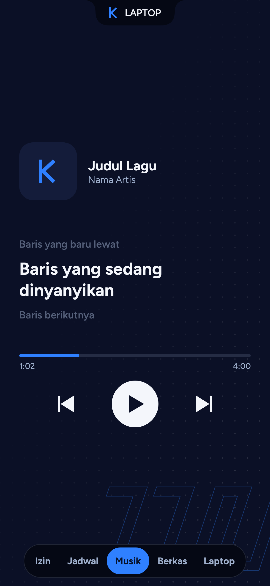

# KALA

**Sakiceup, sagala katempo.** Sekedip mata, semua kelihatan.

[Lihat halaman KALA](https://rezamahendraaa23.github.io/KALA/)

KALA adalah notch di tepi atas layar Windows, dengan aplikasi pendamping di Android. Jadwal sholat, lirik lagu, meeting, dan izin Claude Code terlihat tanpa pindah jendela.

## Pasang

| Perangkat | Unduh | Catatan |
| --- | --- | --- |
| Windows | `KALA_x.y.z_x64-setup.exe` dari [Releases](https://github.com/rezamahendraaa23/KALA/releases/latest) | Belum memakai sertifikat code signing. Kalau SmartScreen muncul, pilih **More info**, lalu **Run anyway**. |
| Android 10+ | [`KALA-android.apk`](https://github.com/rezamahendraaa23/KALA/releases/latest/download/KALA-android.apk) | Dipasang di luar Play Store, jadi Android bisa memperingatkan. |

Keduanya memberi tahu saat ada versi baru. Di laptop, pembaruan dipasang dari Pengaturan > Sistem. Di HP, lewat bar **Perbarui** atau tombol **Cek pembaruan** di tab Laptop.

**Cara pakai:** arahkan kursor atau klik notch untuk membuka panel. Pindah tab dengan scroll mouse, swipe dua jari, dock di bawah panel, atau tombol kiri-kanan. `Ctrl + Alt + K` menyembunyikan dan memunculkan notch.

## Di laptop

### Sholat

Jadwal harian per kota dari MyQuran, termasuk Imsak dan Terbit, dengan pengingat 5 sampai 30 menit sebelumnya. Langitnya mengikuti cuaca kota pilihanmu dari Open-Meteo: matahari, awan, hujan, atau petir, lalu bulan dan bintang saat malam.

### Musik

Mengikuti pemutar yang terdaftar di Windows, seperti Spotify dan browser. Lirik sinkron dicari dari LRCLIB, QQ Music, NetEase, KuGou, dan lyrics.ovh. Tombol komentar menampilkan lirik di panel dan notch; kalau dimatikan, notch hanya menampilkan equalizer.

### Agenda

Membaca kalender Lark lewat CalDAV, tanpa membuat aplikasi di Developer Console, dan tidak mengubah jadwal. Password didapat dari Lark: Settings > Calendar > CalDAV sync. CalDAV hanya mengirim kode ruangan, jadi nama lengkapnya bisa diisi di Pengaturan > Jadwal Lark.

### Fokus

Pomodoro dengan mode fokus, rehat, dan rehat panjang. Selama sesi fokus, notifikasi ditahan dan tetap masuk riwayat, sedangkan izin Claude Code tetap muncul.

### Kirim file

Kalau HP tersambung lewat aplikasi, tab ini langsung siap. Perangkat lain cukup memindai QR di Wi-Fi yang sama. File dari HP masuk ke `Downloads\KALA`.

### Yang lain

- **Izin Claude Code:** permintaan izin di VS Code bisa dijawab dari notch. Mati sampai dinyalakan di Pengaturan > Sistem.
- **Notifikasi:** notifikasi Windows tampil di notch dan tersimpan sebagai riwayat per aplikasi. Tab-nya bisa dimunculkan di Pengaturan > Tab & Navigasi.
- **Penanda singkat:** animasi saat Caps Lock atau mode hening berubah, dan peringatan kalau CPU atau RAM di atas 90% selama satu menit.
- **Tampilan:** bentuk, posisi, ukuran, warna, transparansi, urutan tab, dan isi notch bisa diatur.

## Di HP

Di laptop, buka Pengaturan > Sistem > **Hubungkan HP**, lalu pindai QR dari aplikasi. HP dan laptop harus di Wi-Fi yang sama.

  
  
  

- **Izin Claude Code:** perintah tampil utuh dan harus digeser untuk mengizinkan. Bisa juga dijawab dari notifikasi setelah HP dibuka.
- **Izinkan otomatis:** aktif 8 jam selama HP tersambung. Perintah yang dikenali berisiko, seperti hapus file dan `git push`, tetap ditanya, tapi daftar itu tidak menangkap semuanya.
- **Baca dan balas Claude:** mati sampai dinyalakan di laptop. Sesi dibuka dengan sidik jari. Balasan dari HP tampil di HP, tidak di panel VS Code yang sedang terbuka. Tiap perintah yang bisa mengubah sesuatu harus diizinkan dulu, dan tidak dijawab berarti ditolak.
- **Jadwal dan musik:** waktu sholat, cuaca, meeting hari ini, pengingat meeting, kontrol lagu, dan lirik sinkron.
- **Berkas dan clipboard:** kirim dua arah, termasuk lewat menu Bagikan di Android.
- **Sambung lagi:** setelah diputus, tekan Sambung lagi di HP lalu izinkan di notch, tanpa pindai ulang.

## Data

Pengaturan, riwayat notifikasi, dan jadwal tersimpan di laptop. Password CalDAV dan kunci HP disimpan terenkripsi dengan akun Windows. Data yang keluar dari laptop hanya:

| Data | Ke mana |
| --- | --- |
| Kota yang dipilih | MyQuran dan Open-Meteo |
| Judul, artis, album, dan durasi lagu | Penyedia lirik |
| Permintaan kalender | Server CalDAV Lark, kalau dihubungkan |
| Pemeriksaan versi baru | GitHub |
| Jadwal, lagu, clipboard, izin, dan transkrip Claude yang dinyalakan | HP yang kamu hubungkan, lewat Wi-Fi lokal dan terenkripsi |
| Isi berkas yang dikirim | Perangkat tujuan, lewat Wi-Fi lokal dan **tidak terenkripsi** |

## Batasan

- Dikembangkan dan diuji di Windows 11. Windows 10 belum diuji.
- Fitur HP hanya jalan di Wi-Fi yang sama, dan laptop harus menyala.
- Notifikasi hanya tertangkap dari aplikasi yang memakai notifikasi Windows.
- Nama ruangan dari Lark hanya berupa kode sampai kamu melengkapinya.
- QQ Music, NetEase, dan KuGou bukan API resmi, jadi sewaktu-waktu bisa berhenti bekerja.
- Windows Firewall akan meminta izin saat Kirim file atau HP pertama kali dipakai.

Tangkapan layar memakai jadwal dan lagu contoh.

Dibuat oleh Reza Mahendra.
