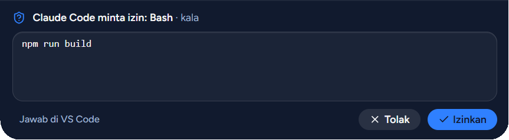
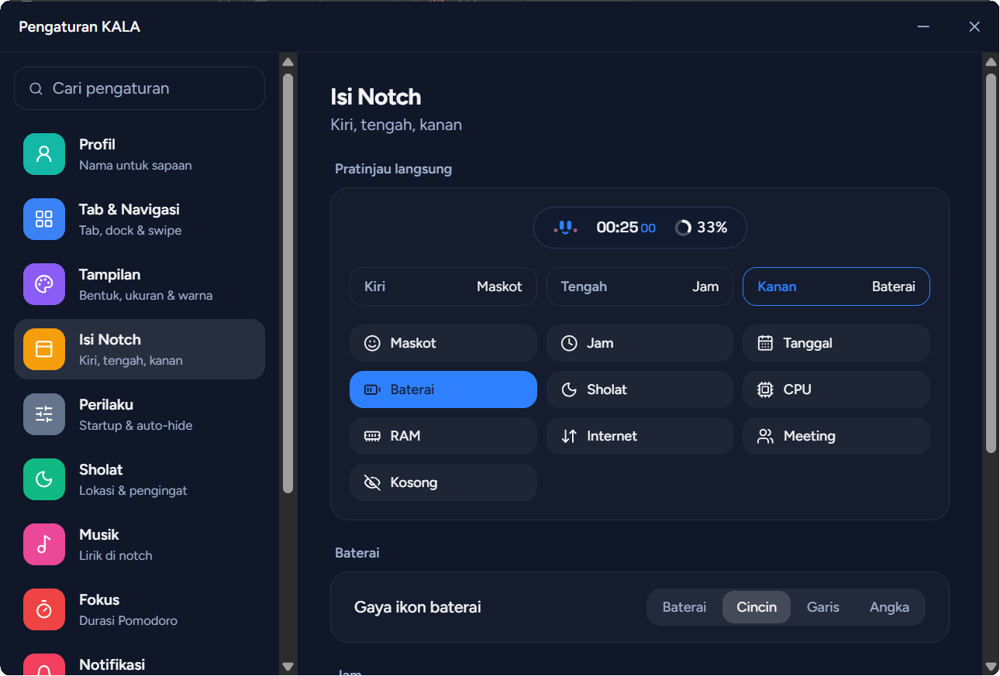
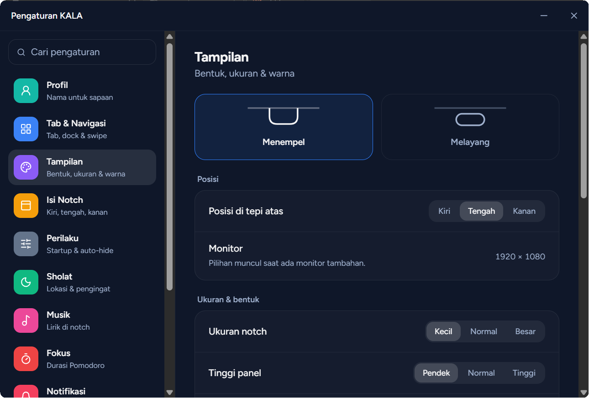

# KALA

Sakiceup, Sagala Katempo.

KALA adalah notch di tepi atas layar Windows. Jadwal sholat, lagu yang sedang diputar, meeting, dan notifikasi terlihat tanpa pindah jendela.

Arahkan kursor atau klik notch untuk membuka panel. Pindah tab dengan swipe dua jari di touchpad, dock di bawah panel, atau tombol kiri-kanan. Tekan `Ctrl + Alt + K` untuk menyembunyikan atau memunculkannya.

## Pasang

Unduh `KALA_x.y.z_x64-setup.exe` dari halaman [Releases](https://github.com/rezamahendraaa23/KALA/releases/latest), lalu jalankan.

Installer belum memakai sertifikat code signing, jadi Windows SmartScreen bisa menampilkan peringatan. Pilih **More info**, lalu **Run anyway**.

Setelah terpasang, KALA memberi tahu saat ada versi baru. Pembaruan dipasang dari Pengaturan > Sistem.

## Fitur

### Home

Jam, ringkasan sholat, meeting, dan lagu, plus satu garis waktu untuk hari ini.

### Sholat

Jadwal harian per kota dari MyQuran, termasuk Imsak dan Terbit. Waktu yang sudah lewat bisa ditandai sudah sholat. Pengingat muncul 5 sampai 30 menit sebelumnya dan saat waktunya masuk.

### Musik

Mengikuti pemutar yang terdaftar di Windows, seperti Spotify dan browser. Bisa putar, jeda, ganti lagu, geser posisi, dan atur volume. Lirik sinkron dicari dari LRCLIB, QQ Music, NetEase, KuGou, dan lyrics.ovh. Tombol komentar di panel Musik menampilkan lirik di panel dan di notch; kalau dimatikan, notch hanya menampilkan equalizer.

### Agenda

Membaca kalender Lark lewat CalDAV, tanpa membuat aplikasi di Developer Console. Hanya membaca, tidak mengubah jadwal. Password didapat dari Lark: Settings > Calendar > CalDAV sync. CalDAV hanya mengirim kode ruangan, jadi nama lengkapnya bisa diisi sendiri di Pengaturan > Jadwal Lark.

### Notifikasi

Notifikasi Windows tampil di notch dan tersimpan sebagai riwayat per aplikasi. Ada mode Jangan Ganggu, dan aplikasi tertentu bisa dibisukan.

### Fokus

Pomodoro dengan mode fokus, rehat, dan rehat panjang. Timer tetap terlihat di notch saat panel tertutup. Selama sesi fokus, notifikasi ditahan dan tetap masuk riwayat, sedangkan izin Claude Code tetap muncul.

### Kirim file

Scan QR dari HP di Wi-Fi yang sama untuk mengirim file dua arah. File dari HP masuk ke `Downloads\KALA`.

### Izin Claude Code

Permintaan izin Claude Code di VS Code bisa dijawab dari notch. Fitur ini mati sampai dinyalakan di Pengaturan > Sistem.

## Aplikasi Android

Unduh `KALA-android.apk` dari halaman [Releases](https://github.com/rezamahendraaa23/KALA/releases/latest), pasang, lalu pindai QR dari Pengaturan > Sistem > Hubungkan HP. HP dan laptop harus di Wi-Fi yang sama.

  
  
  

- **Izin Claude Code:** perintah tampil utuh dan harus digeser untuk mengizinkan. Bisa juga dijawab dari notifikasi setelah HP dibuka.
- **Izinkan otomatis:** aktif 8 jam selama HP tersambung. Perintah yang dikenali berisiko, seperti hapus file dan `git push`, tetap ditanya, tapi daftar itu tidak menangkap semuanya.
- **Jadwal:** waktu sholat dan meeting hari ini, plus pengingat meeting di HP.
- **Musik:** putar, jeda, ganti lagu, dan lirik sinkron.
- **Berkas dan clipboard:** kirim dua arah, termasuk lewat menu Bagikan di Android.
- **Sambung lagi:** setelah diputus, tekan Sambung lagi di HP lalu izinkan di notch. Tidak perlu pindai ulang.
- **Pembaruan:** aplikasi memberi tahu saat ada versi baru di Releases.

Permintaan izin, jadwal, musik, dan clipboard terenkripsi. Isi berkas yang dikirim tidak.

## Pengaturan

Bentuk menempel atau melayang, posisi, ukuran, warna, transparansi, blur, urutan tab, dan gaya ikon baterai bisa diubah. Isi kiri, tengah, dan kanan notch bisa dipilih: jam, tanggal, baterai, sholat, meeting, CPU, RAM, internet, atau maskot.

## Batasan

- Dikembangkan dan diuji di Windows 11. Windows 10 belum diuji.
- Notifikasi hanya tertangkap dari aplikasi yang memakai notifikasi Windows. Aplikasi dengan pop-up sendiri tidak ikut.
- Lokasi meeting mengikuti data CalDAV dari Lark, yang bisa lebih singkat dari nama di aplikasi Lark.
- KuGou dan NetEase bukan API resmi, jadi sewaktu-waktu bisa berhenti bekerja.
- Kirim file tidak terenkripsi. Pakai hanya di Wi-Fi yang dipercaya.
- Windows Firewall akan meminta izin saat Kirim file pertama kali dipakai.

## Data

Pengaturan, riwayat notifikasi, dan jadwal tersimpan di laptop. Password CalDAV disimpan terenkripsi dengan akun Windows. Data yang keluar hanya:

- Kota yang dipilih, ke MyQuran.
- Judul, artis, album, dan durasi lagu, ke penyedia lirik.
- Permintaan kalender, ke server CalDAV Lark, kalau dihubungkan.
- Pemeriksaan versi baru, ke GitHub.
- Jadwal, lagu yang diputar, clipboard, dan permintaan izin, ke HP yang kamu hubungkan, hanya lewat Wi-Fi lokal.

Dibuat oleh Reza Mahendra.
